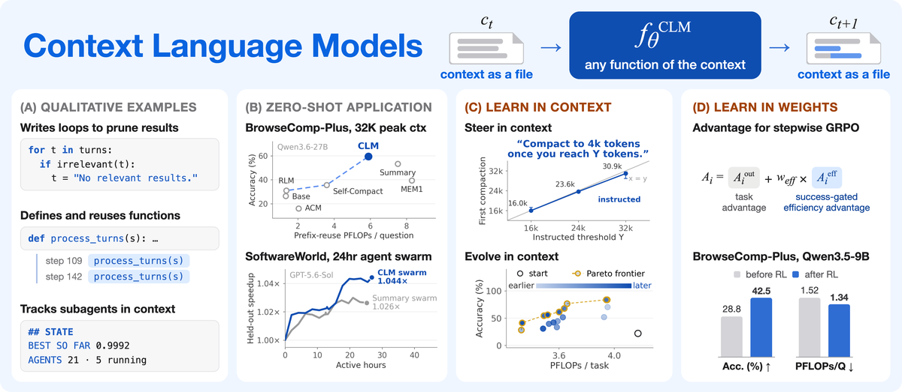
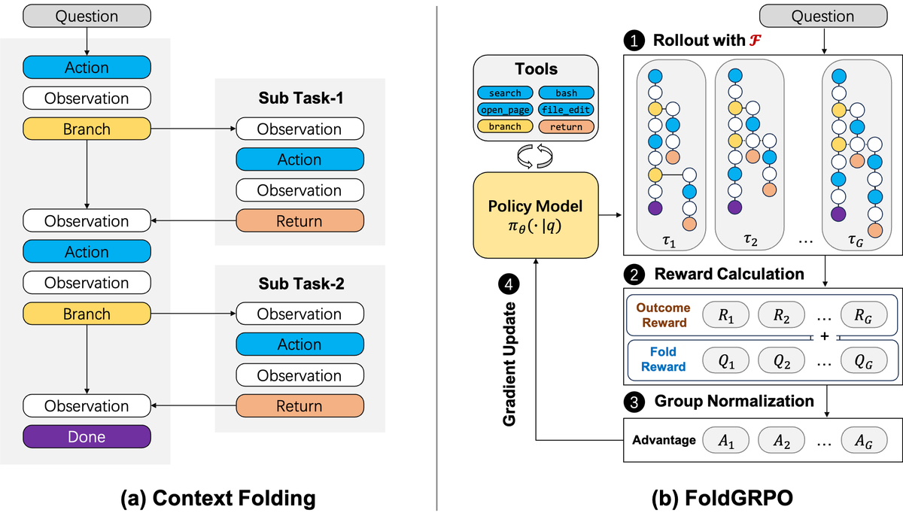
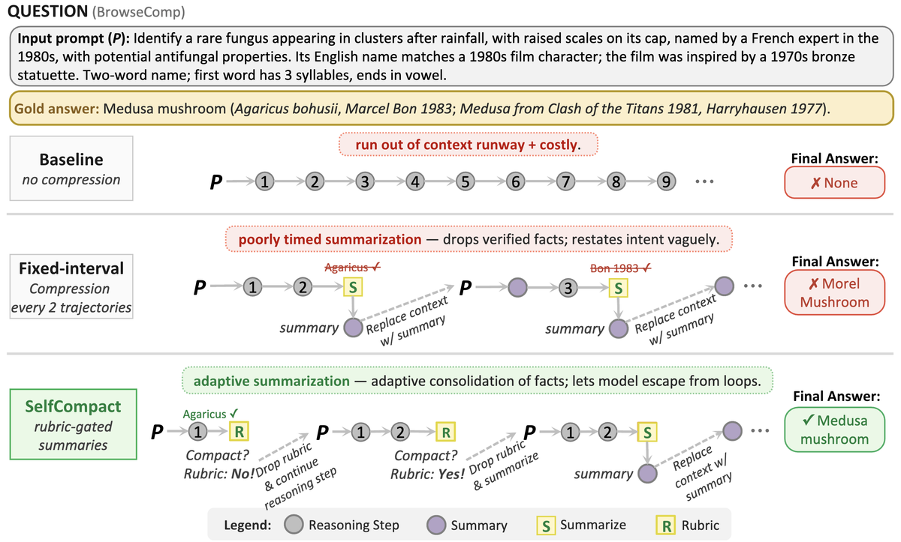
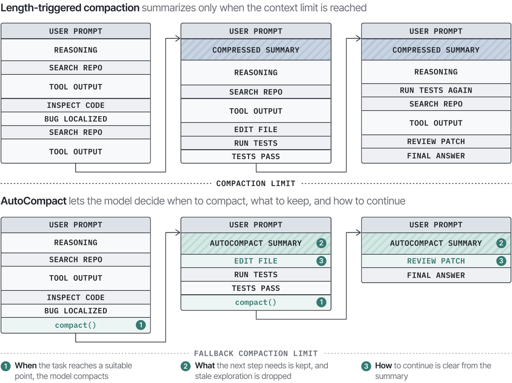
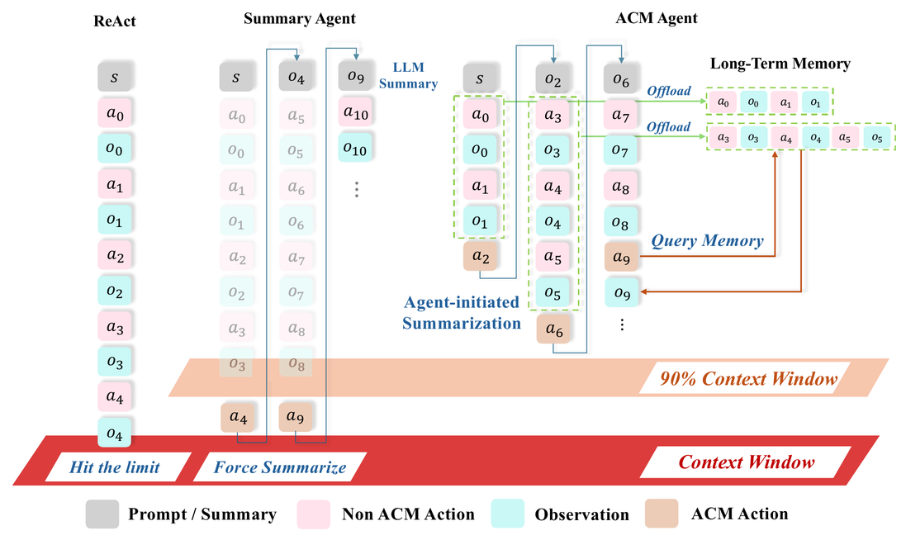
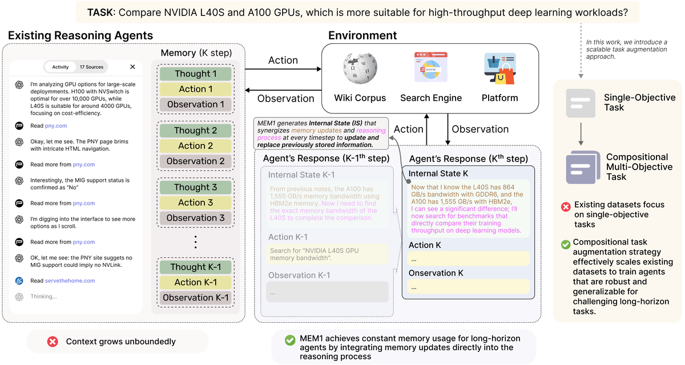
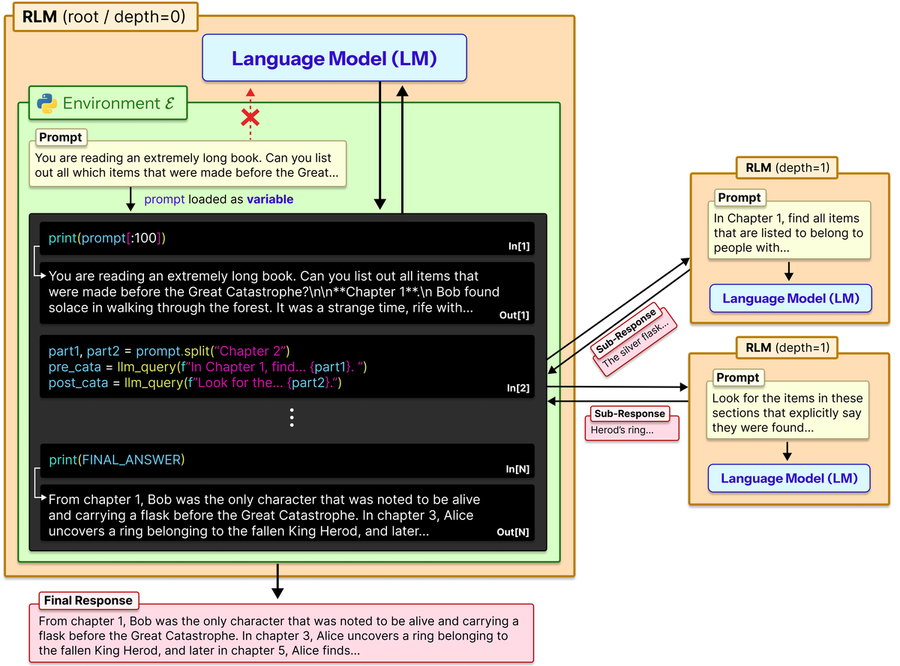

# OpenContext

Context management for coding agents. OpenContext sits between your coding agent and its model's
API, and on every request decides what the model sees: Codex-style compaction, a context the
model edits itself, context folding, and more. Your agent, its login and its provider stay as
they are.

## Supported agents

| | Agent | Name for `opencontext setup` | Checked with |
| --- | --- | --- | --- |
|  | [Codex](https://github.com/openai/codex) | `codex` | 0.162.0–0.163.0 |
|  | [Claude Code](https://github.com/anthropics/claude-code) | `claude_code` | 2.1.294 |
|  | [Gemini CLI](https://github.com/google-gemini/gemini-cli) | `gemini_cli` | 0.63.0 |
|  | [OpenCode](https://github.com/anomalyco/opencode) | `opencode` | 1.19.0 |
|  | [Kilo](https://github.com/Kilo-Org/kilocode) | `kilo` | 7.8.8 |
|  | [pi](https://github.com/earendil-works/pi) | `pi` | 1.1.0 |
|  | [Crush](https://github.com/charmbracelet/crush) | `crush` | 0.98.1 |
|  | [OpenClaw](https://github.com/openclaw/openclaw) | `openclaw` | 2026.10.1 |
|  | [Kimi Code](https://github.com/MoonshotAI/kimi-code) | `kimi_code` | 2.1.1 |
|  | [Goose](https://github.com/aaif-goose/goose) | `goose` | 1.54.0 |
|  | [Hermes Agent](https://github.com/NousResearch/hermes-agent) | `hermes` | 0.19.0 |
|  | [nanobot](https://github.com/HKUDS/nanobot) | `nanobot` | 0.3.5 |
|  | [DeepSeek Harness](https://github.com/deepseek-ai/deepseek-harness) | `deepseek_harness` | 0.2.0-rc.2 |
|  | [WorkBuddy / CodeBuddy Code](https://www.workbuddy.ai/) | `workbuddy` | 2.164.0 |
|  | [mini-swe-agent](https://github.com/SWE-agent/mini-swe-agent) | `mini_swe` | 2.4.6 |

A newer release of an agent works as the newest one checked; `opencontext status` notes it.

## Install

### Ask your agent

Send this to your coding agent:

> Set up OpenContext for yourself: install it with
> `curl -fsSL https://raw.githubusercontent.com/sunnweiwei/OpenContext/main/install.sh | sh`,
> then run `opencontext help` and follow "For a coding agent asked to set OpenContext up".

It installs OpenContext, points itself at it, and asks you to approve what runs outside its
sandbox. Conversations you start afterwards use OpenContext.

### By hand

```bash
curl -fsSL https://raw.githubusercontent.com/sunnweiwei/OpenContext/main/install.sh | sh
opencontext setup codex                # or another name from the table above
```

The installer needs Python 3.11 or newer (or [uv](https://docs.astral.sh/uv/)). `opencontext setup`
starts OpenContext and points the agent at it, recording each setting it changes.

## Use

```bash
opencontext strategy clm        # change the strategy: every conversation, from its next request
opencontext status              # whether it runs, its strategy, the agents set up
opencontext uninstall codex     # point the agent back at its provider (--all: every agent)
opencontext help                # the full guide
```

Strategies are below. Each runs with every agent above.

If a conversation grew past the model's window through OpenContext, `opencontext uninstall` says
so and keeps it working until you run the agent's own `/compact` in it; then the agent goes direct.

## Strategies

**`compaction`** (default). Codex's local compaction
([codex-rs/core/src/compact.rs](https://github.com/openai/codex/blob/main/codex-rs/core/src/compact.rs)),
on every agent: past a threshold, the history becomes a summary, and the recent user messages are kept.

**`clm`**. [Context Language Models](https://arxiv.org/abs/2609.37725) (Shao et al., 2026). The model
edits its own context, kept as a file, with its ordinary tools.

<br>
<sub>Figure from Shao et al., <i>Context Language Models</i> (arXiv:2609.37725), CC BY 4.0.</sub>

**`folding`**. [Context-Folding](https://arxiv.org/abs/2510.11967) (Sun et al., 2025). The agent
branches off a sub-task, and when it returns, the branch's steps fold into its message.

<br>
<sub>Figure from Sun et al., <i>Scaling Long-Horizon LLM Agent via Context-Folding</i> (arXiv:2510.11967); OpenContext runs (a).</sub>

**`prolong`**. [PRO-LONG](https://arxiv.org/abs/2607.20064) (Fox et al., 2026). Compaction, plus a
log of the whole session that the agent searches with its own tools.

**`selfcompact`**. [Self-Compacting Language Model Agents](https://arxiv.org/abs/2606.23525) (Li et
al., 2026). A rubric decides when the model summarizes its own trajectory.

<br>
<sub>Figure from Li et al., <i>Self-Compacting Language Model Agents</i> (arXiv:2606.23525), CC BY 4.0.</sub>

**`autocompact`**. [AutoCompact](https://arxiv.org/abs/2610.02163) (Zhang et al., 2026). The model
decides when to compact, what to keep, and how to continue.

<br>
<sub>Figure from Zhang et al., <i>AutoCompact: Learning When to Compact Context in Long-Horizon Coding Agents</i> (arXiv:2610.02163), CC BY 4.0.</sub>

**`acm`**. [ACM: Agentic Context Management](https://arxiv.org/abs/2607.23809) (Li et al., 2026). The
model compresses its context when it decides to, and recalls what it compressed.

<br>
<sub>Figure from Li et al., <i>ACM: Agentic Context Management for Long Horizon Tasks</i> (arXiv:2607.23809), CC BY 4.0.</sub>

**`mem1`**. [MEM1](https://arxiv.org/abs/2506.15841) (Zhou et al., 2025). The model carries its
memory in an internal state it rewrites every turn.

<br>
<sub>Figure from Zhou et al., <i>MEM1: Learning to Synergize Memory and Reasoning for Efficient Long-Horizon Agents</i> (arXiv:2506.15841), CC BY 4.0.</sub>

**`rlm`**. [Recursive Language Models](https://arxiv.org/abs/2512.24601) (Zhang, Kraska and Khattab,
2025). The conversation becomes a variable in a Python REPL that the model works over, calling
itself on parts of it. It runs code the model writes.

<br>
<sub>Figure from Zhang, Kraska and Khattab, <i>Recursive Language Models</i> (arXiv:2512.24601), CC BY 4.0.</sub>

More: [docs/design.md](docs/design.md) (how it works, how each agent is handled, evaluations).
