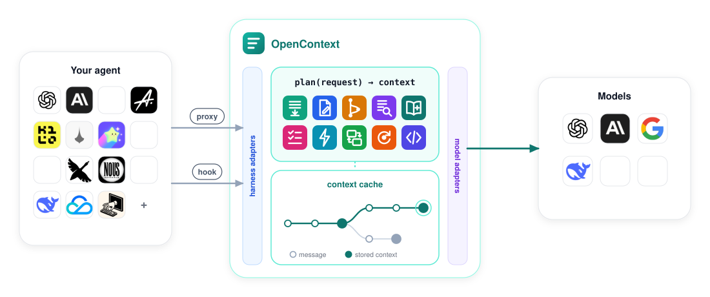

# OpenContext

Context management for coding agents. OpenContext sits between your coding agent and its model's
API, and on every request decides what the model sees. Your agent, its login and its provider stay
as they are, and every strategy works with every agent.

<div align="center">

**15 agents**

<table>
<tr>
<td align="center" width="120"><a href="https://github.com/openai/codex"><br><sub>Codex</sub></a></td>
<td align="center" width="120"><a href="https://github.com/anthropics/claude-code"><br><sub>Claude Code</sub></a></td>
<td align="center" width="120"><a href="https://github.com/google-gemini/gemini-cli"><br><sub>Gemini CLI</sub></a></td>
<td align="center" width="120"><a href="https://github.com/anomalyco/opencode"><br><sub>OpenCode</sub></a></td>
<td align="center" width="120"><a href="https://github.com/Kilo-Org/kilocode"><br><sub>Kilo</sub></a></td>
</tr>
<tr>
<td align="center" width="120"><a href="https://github.com/earendil-works/pi"><br><sub>pi</sub></a></td>
<td align="center" width="120"><a href="https://github.com/charmbracelet/crush"><br><sub>Crush</sub></a></td>
<td align="center" width="120"><a href="https://github.com/openclaw/openclaw"><br><sub>OpenClaw</sub></a></td>
<td align="center" width="120"><a href="https://github.com/MoonshotAI/kimi-code"><br><sub>Kimi Code</sub></a></td>
<td align="center" width="120"><a href="https://github.com/aaif-goose/goose"><br><sub>Goose</sub></a></td>
</tr>
<tr>
<td align="center" width="120"><a href="https://github.com/NousResearch/hermes-agent"><br><sub>Hermes Agent</sub></a></td>
<td align="center" width="120"><a href="https://github.com/HKUDS/nanobot"><br><sub>nanobot</sub></a></td>
<td align="center" width="120"><a href="https://github.com/deepseek-ai/deepseek-harness"><br><sub>DeepSeek Harness</sub></a></td>
<td align="center" width="120"><a href="https://www.workbuddy.ai/"><br><sub>WorkBuddy</sub></a></td>
<td align="center" width="120"><a href="https://github.com/SWE-agent/mini-swe-agent"><br><sub>mini-swe-agent</sub></a></td>
</tr>
</table>

<h3>×</h3>

**10 strategies**

<table>
<tr>
<td align="center" width="120"><br><sub><b><code>compaction</code></b><br>Codex compaction<br><a href="https://github.com/openai/codex/blob/main/codex-rs/core/src/compact.rs">Codex</a></sub></td>
<td align="center" width="120"><br><sub><b><code>clm</code></b><br>CLM<br><a href="https://arxiv.org/abs/2609.37725">paper</a></sub></td>
<td align="center" width="120"><br><sub><b><code>folding</code></b><br>Context-Folding<br><a href="https://arxiv.org/abs/2510.11967">paper</a></sub></td>
<td align="center" width="120"><br><sub><b><code>prolong</code></b><br>PRO-LONG<br><a href="https://arxiv.org/abs/2607.20064">paper</a></sub></td>
<td align="center" width="120"><br><sub><b><code>selfcompact</code></b><br>Self-Compact<br><a href="https://arxiv.org/abs/2606.23525">paper</a></sub></td>
</tr>
<tr>
<td align="center" width="120"><br><sub><b><code>autocompact</code></b><br>AutoCompact<br><a href="https://arxiv.org/abs/2610.02163">paper</a></sub></td>
<td align="center" width="120"><br><sub><b><code>acm</code></b><br>ACM<br><a href="https://arxiv.org/abs/2607.23809">paper</a></sub></td>
<td align="center" width="120"><br><sub><b><code>mem1</code></b><br>MEM1<br><a href="https://arxiv.org/abs/2506.15841">paper</a></sub></td>
<td align="center" width="120"><br><sub><b><code>rlm</code></b><br>RLM<br><a href="https://arxiv.org/abs/2512.24601">paper</a></sub></td>
<td align="center" width="120"><br><sub><b><code>ace</code></b><br>ACE<br><a href="https://arxiv.org/abs/2510.04618">paper</a></sub></td>
</tr>
</table>

</div>

Releases of each agent checked: [docs/design.md](docs/design.md#support). A newer release works
as the newest one checked; `opencontext status` notes it.

## How it works

<p align="center"></p>

- **Proxy or hook**: your agent connects either way; its login and provider stay the same.
- **Stateless**: the agent sends its full history; OpenContext resumes from the longest cached prefix.
- **Uninstall**: the agent goes direct again.

## Install

### Ask your agent

Send this to your coding agent:

> Set up OpenContext for yourself: install it with
> `curl -fsSL https://raw.githubusercontent.com/sunnweiwei/OpenContext/main/install.sh | sh`,
> then run `opencontext help` and follow "For a coding agent asked to set OpenContext up".

It installs OpenContext, points itself at it, and asks you to approve what runs outside its
sandbox. Conversations you start afterwards use OpenContext.

### By hand

```bash
curl -fsSL https://raw.githubusercontent.com/sunnweiwei/OpenContext/main/install.sh | sh
opencontext setup codex      # or: claude, gemini_cli, opencode, kilo, pi, crush, openclaw,
                             #     kimi_code, goose, hermes, nanobot, dsh, workbuddy, mini
```

The installer needs Python 3.11 or newer (or [uv](https://docs.astral.sh/uv/)). `opencontext setup`
starts OpenContext and points the agent at it, recording each setting it changes.

## Use

```bash
opencontext strategy clm        # change the strategy (a name from the grid above): every
                                # conversation, from its next request
opencontext status              # whether it runs, its strategy, the agents set up
opencontext uninstall codex     # point the agent back at its provider (--all: every agent)
opencontext help                # the full guide
```

If a conversation grew past the model's window through OpenContext, `opencontext uninstall` says
so and keeps it working until you run the agent's own `/compact` in it; then the agent goes direct.

More: [docs/design.md](docs/design.md) (how it works, how each agent is handled, evaluations).
